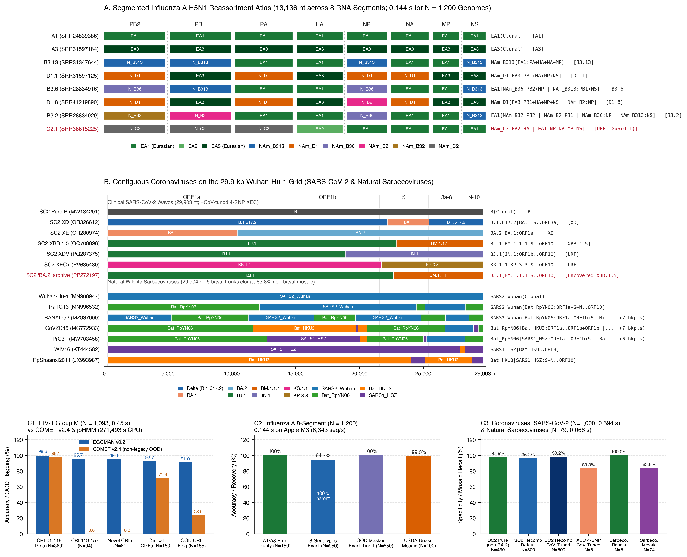
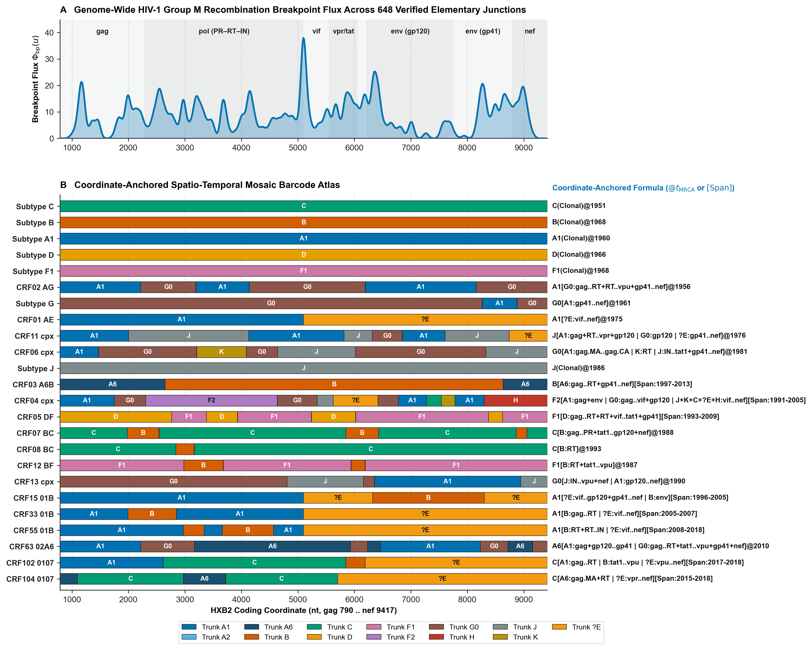
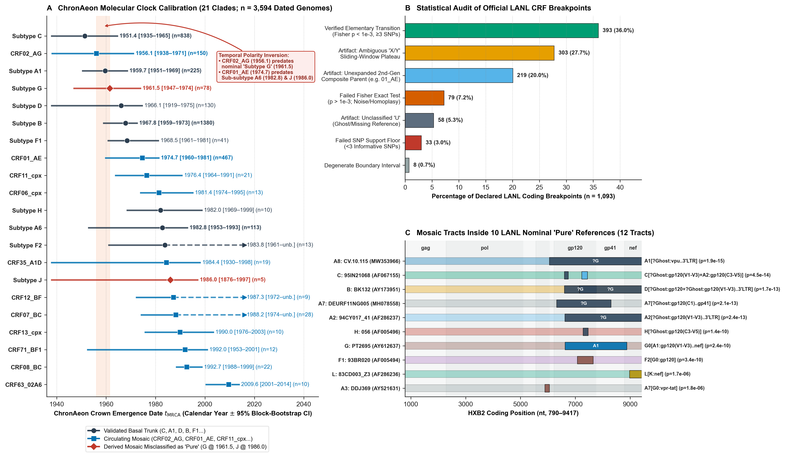
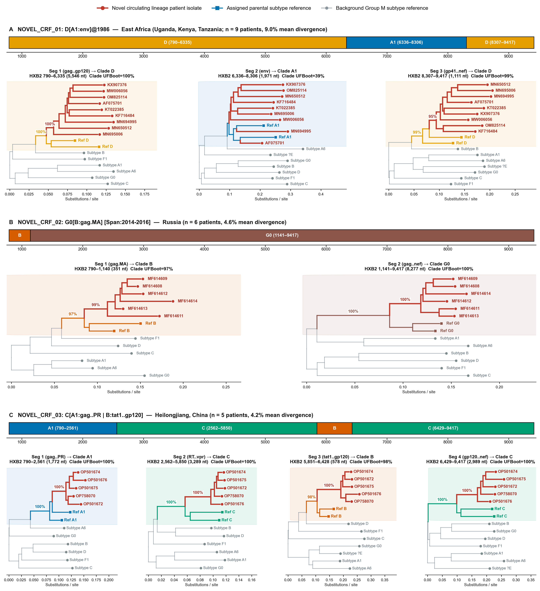
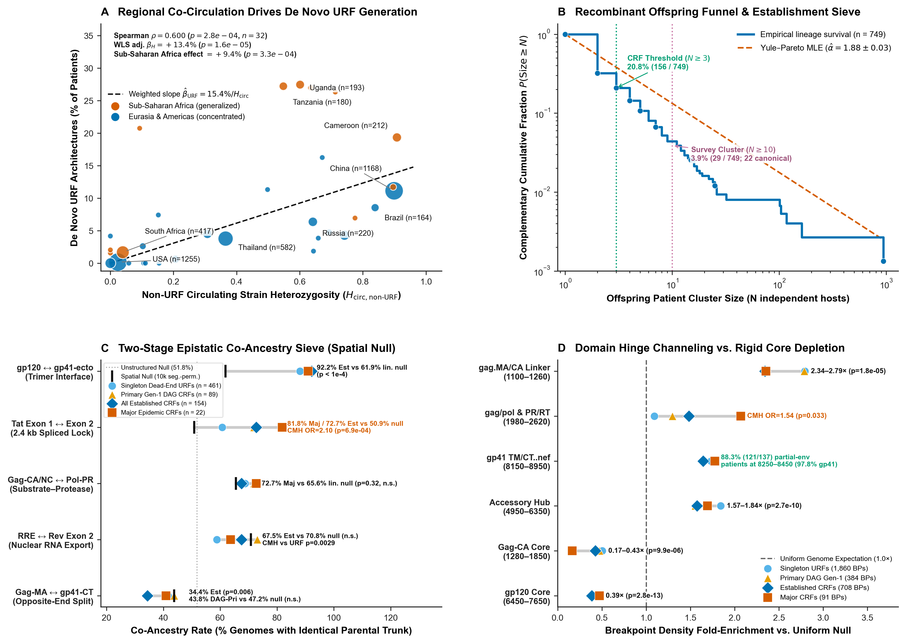

# EGGMAN

**E**xact **G**enomic **G**enealogy and **M**osaic **A**ncestry **N**omenclature

[](#installation--rust-cli)
[](https://veg.github.io/eggman/)
[](.github/workflows/ci.yml)

> *"Come together: coordinate-anchored recombination, segment reassortment, and mosaic nomenclature across pandemic RNA viruses."*

**EGGMAN** is a native Rust (`eggman-core`, `eggman-cli`) and WebAssembly (`eggman-wasm`) engine for **cross-pathogen mosaic deconvolution, reassortment calling, and evolutionary nomenclature**. Rather than flattening recombinant or reassorted viruses into arbitrary sequential integers (`CRF01`–`CRF157`, Pango `X*` prefixes, or unindexed `URF` strings), EGGMAN projects unaligned or pre-aligned genomes onto canonical viral coordinates, verifies template switches or segment exchanges with exact Fisher tests, and reports deterministic coordinate barcodes alongside statistically guarded lineage calls.

Through declarative **`PathogenSpec` profile packs (`--pack`)**, the exact same segmentation, guard, and naming math operates out of the box on both **contiguous template-switching viruses** (HIV-1 Group M, SARS-CoV-2, bat/pangolin sarbecoviruses) and **multipartite segmented reassorting viruses** (8-segment Influenza A H5N1)—with **zero source code changes**.

<p align="center">
  
</p>

---

## Multi-Pathogen Scope (`--pack`)

Every biological assumption—genome span, gene landmarks, basal trunk consensuses, segmentation boundaries, and certified clade constellations—lives cleanly inside an external JSON/FASTA/TSV bundle rather than hard-coded branches:

| Pathogen Pack | Genome Type | Reference Span | Key Mechanism Modeled | Example Verified Coordinate Barcode | Empirical Batch Throughput (M3) |
| :--- | :--- | :--- | :--- | :--- | :--- |
| **HIV-1 Group M** *(built-in default)* | Contiguous retrovirus | `8,628 nt` (`HXB2 790–9417`) | Template switching + locus-restricted `?E` trunk | `D[A1:env]@1986` | **`2,435 seq/s`** (`0.45 s` / 1,093 seqs) |
| [`packs/influenza_a_8seg`](packs/influenza_a_8seg) | **8-segment** RNA virus | `13,136 nt` (`PB2`–`NS`) | Zero-penalty segment reassortment ($\gamma = 0$) + intra-segment lock ($10^6$) | `NAm_B313[EA1:PA+HA+NA+MP]` | **`8,343 seq/s`** (`0.144 s` / 1,200 seqs) |
| [`packs/sars_cov2_wuhan`](packs/sars_cov2_wuhan) | Contiguous coronavirus | `29,903 nt` (`Wuhan-Hu-1`) | 32-bit coordinate anchoring + tunable low-SNP floor ($n_{\min} \ge 3$) | `BJ.1[BM.1.1.1:S..ORF10]` | **`2,539 seq/s`** (`0.394 s` / 1,000 seqs) |
| [`packs/sarbecovirus_wuhan`](packs/sarbecovirus_wuhan) | Divergent coronavirus | `29,904 nt` (`Wuhan-Hu-1`) | Deep homologous recombination over basal wildlife clades | `SARS2_Wuhan[Bat_RpYN06:ORF1a+S+N..ORF10]` | **`1,197 seq/s`** (`0.066 s` / 79 seqs) |

```bash
# Default HIV-1 Group M full genomes or partial pol/env amplicons (aligned or unaligned)
eggman query_hiv.fasta --out results.csv --json results.json

# 8-segment Influenza A H5N1 reassortment calling (e.g., B3.13 dairy cattle, D1.1 bird)
eggman h5n1_concatenated.fasta --pack packs/influenza_a_8seg --out flu_calls.csv

# Clinical SARS-CoV-2 surveillance (low-divergence coronavirus tuning)
eggman sc2.fasta --pack packs/sars_cov2_wuhan --gamma 3.5 --min-snps 3 --p-thresh 0.01

# Natural bat/pangolin sarbecovirus genomes
eggman sarbeco.fasta --pack packs/sarbecovirus_wuhan --out sarbeco_calls.csv

# Export the built-in HIV-1 PathogenSpec manifest as a starting template for any virus
eggman --export-default-pack custom_pack/manifest.json
```

---

## Core Architecture

1. **Seeded 32-Bit Coordinate Projection & Unmasked Alignment**
   - Indexes exact $15$-mer anchors ($4^{-15} = 9.31 \times 10^{-10} \ll 1/L$) stored as **32-bit unsigned reference offsets**, accommodating viral chromosomes well past $20\text{ kb}$ alongside an $11$-mer fallback for divergent amplicons.
   - Chains collinear anchors and runs **banded Needleman–Wunsch dynamic programming** ($B = |\Delta L| + 35\text{ nt}$ / $45\text{ nt}$ default) without masking HIV-1 drug-resistance codons in `pol`, preserving short clinically diagnostic insertions such as the $216\text{-nt}$ Subtype `B` `pol.RT` tract (`HXB2 2964–3179`) in `CRF07_BC`.

2. **Two-Tier Mosaic Deconvolution vs. Guarded Clade Calling**
   - **Tier 1 (Invariant Basal Barcode):** Runs penalized Viterbi segmentation over clean scrubbed basal trunks (14 trunks for HIV-1 including scrubbed `G0` and the `vif–nef`-restricted `?E` ghost trunk) with Dirichlet-multinomial emissions ($\alpha = 0.08$). On segmented pathogens (`is_segmented = true`), the transition penalty $\gamma(x)$ drops to **`0 nats`** at inter-segment boundaries and locks at **`10^6 nats`** within segments. Every candidate crossover requires flanking span coverage, $\ge n_{\min}$ diagnostic SNPs ($|\Delta \ln P| \ge 0.5\text{ nats}$), and two-sided $2 \times 2$ Fisher exact verification ($p_{\mathrm{Fisher}} < 10^{-4}$).
   - **Tier 2 (Guarded Certified Clade Caller):** Evaluates curated clade consensuses (`165` HIV-1 profiles; USDA/Pango constellations in external packs) across four strict statistical checks—**(1)** coverage/identity plurality, **(2)** recombination-DAG parent binomial dominance ($n_c - n_u \ge 5$), **(3)** lineage-defining clade-stem synapomorphies ($\Delta_{\mathrm{stem}} \ge 8$, $p \le 10^{-4}$), and **(4)** a linear-time **Kadane maximum-subarray residual scan** ($\ge 80\text{ nt}$, $\max S \ge 12$, $p < 10^{-4}$) against rival founders—defaulting uncertified or novel mosaics safely to `URF`.

3. **Canonical Descriptive Coordinate Grammar & Partition Clocking (`ChronAeon`)**
   - Encodes verified mosaic paths deterministically under a formal Backus–Naur Form grammar (`<Backbone>[<Donor>:<GeneSpan>]@<Scope>`, separating independent donors by `|`, disjoint regions by `+`, and spans by `..`).
   - Paired with companion tree-free molecular clock estimator [`ChronAeon`](https://zenodo.org/records/23560893) (exponential early-sample weighting $\lambda = 0.10\text{ yr}^{-1}$, Steiner $\frac{1}{2} h_{QQ}$ heterozygosity subtraction, Jukes–Cantor Gamma $\alpha_{\Gamma} = 0.20$, and genomic block-bootstrap CIs; validated against `LSD2` $\rho = 0.814$ and `TreeTime` $\rho = 0.791$).

---

## Key Scientific Findings (Manifold Atlas & Manuscript Figures)

### 1. Genome-Wide Breakpoint Flux & Coordinate Barcode Atlas
Coordinate deconvolution eliminates opaque sequential aliases across generations of recombinants while mapping HIV-1 breakpoint density to structural boundaries:

<p align="center">
  
</p>

### 2. Basal Reference Scrubbing & LANL Breakpoint Audit
Auditing the 2023 LANL compendium uncovers **12 verified foreign tracts inside 10 nominal "pure" references** (all four Subtype G references carry ancestral `G0[A1:gp41..nef]`), restores the 1956 emergence of `CRF02_AG` ahead of Subtype G (`1961.5`), and shows that **64.0% (`700/1,093`) of legacy declared CRF boundaries lack elementary Fisher support** (`6` clonal collapses, `15` redundant aliases, and `48.2%` of mosaic CRFs descending from just three founder hubs across a 3-generation DAG):

<p align="center">
  
</p>

### 3. Discovery & Phylogenetic Confirmation of 38 Unindexed Circulating Lineages
Patient deduplication (`<0.8%` Hamming threshold across `31,825` full genomes and `120,930` partial reads) unites `38` unrecognized circulating HIV-1 lineages across `29` countries (`15` full-genome clusters confirmed across **`75/75` IQ-TREE 2 segment trees** at `100%` median `UFBoot`, plus `23` strictly partial *pol*/*env* lineages including the 86-patient East African `D[A1:env]@1986` cluster spanning 26 studies):

<p align="center">
  
</p>

### 4. Ecological Co-Circulation Supply & Two-Stage Epistatic Fitness Sieve
While national circulating heterozygosity $H_{\mathrm{circ}}$ governs upstream generation ($\rho = 0.600, p = 2.83 \times 10^{-4}$; WLS $R^2 = 0.667$), Yule–Pareto cluster scaling ($\hat{\alpha} = 1.88$) splits survival into a **Stage 1 folding sieve** (depleting breakpoints in `gp120` [`0.39x`] and `Gag-CA` [`0.43x`] cores and preserving `gp120`–`gp41-ecto` co-ancestry at `92.2%`) and a **Stage 2 transmission sieve** (escalating spliced `tat` exon 1–exon 2 co-ancestry from `60.7%` in singletons to `72.7%` in established CRFs [CMH `OR = 2.10`] and `81.8%` in major CRFs [`OR = 3.60`]):

<p align="center">
  
</p>

---

## Empirical Benchmarks

### Cross-Pathogen Benchmarks (`--pack` on Apple M3, `N = 2,279` Non-HIV Genomes)

| Pathogen Pack | Cohort Evaluated | $N$ | Runtime (`s`) | Specificity | Mosaic / Genotype Accuracy | Highlighted Operating Behavior |
| :--- | :--- | :---: | :---: | :---: | :---: | :--- |
| `influenza_a_8seg` (`13,136 nt`) | Pure Eurasian `A1`, `A3` founders | 150 | 0.144 | **100.0%** clonal | — | Zero Tier-1 or Tier-2 false reassortants |
| `influenza_a_8seg` (`13,136 nt`) | 8 H5N1 reassortant genotypes | 950 | 0.144 | — | **94.74%** exact / **100.0%** parent | **100%** on `B3.13` (`500/500`), `D1.1` (`150/150`), `B3.6`, `B2.1`, `D1.3`, `D1.8`, `B3.2`; conservative `URF` on `C2.1` |
| `influenza_a_8seg` (`13,136 nt`) | Masked `B3.13` + `D1.1` OOD holdout | 650 | 0.096 | **100.0%** `URF` | **100.0%** exact Tier-1 | Exact 8-segment formulas for all `650/650` unseen isolates |
| `influenza_a_8seg` (`13,136 nt`) | USDA-unassigned assemblies | 100 | 0.144 | — | **99.0%** mosaic | Recovers `62` `D1.8` and `18` novel `URF` constellations |
| `sars_cov2_wuhan` (`29,903 nt`) | Parental waves ($\gamma = 7.0, n_{\min}=5$) | 500 | 0.394 | **94.4%** (**97.9%** non-`BA.2`) | — | Uncovers `9` `XBB.1.5`/`XBB.1.16` + `1` `XBC` in Spike-archived `BA.2` |
| `sars_cov2_wuhan` (`29,903 nt`) | Clinical recombinants ($\gamma = 7.0$) | 500 | 0.394 | — | **91.6%** exact / **96.2%** Tier-1 | **100%** `XD`/`XE`, `98.1–98.2%` `XBB`/`XBB.1.16`, flags `XDV` as `URF` |
| `sars_cov2_wuhan` (`29,903 nt`) | CoV-tuned ($\gamma = 3.5, n_{\min}=3, p<0.01$) | 1,000 | 0.379 | 89.2% Tier-1 | **98.2%** Tier-1 | Rescues **`5/6` (`83.3%`)** 4-SNP `XEC` (`KS.1.1[KP.3.3:S..ORF10]`) |
| `sarbecovirus_wuhan` (`29,904 nt`) | Non-redacted whole genomes | 79 | 0.066 | **5/5** clonal basals | **83.8%** (`62/74`) mosaic | Median `5.0` breakpoints (`RaTG13`, `BANAL-52`, `CoVZC45`, `PrC31`); 4 all-`N` entries excluded |

### HIV-1 Nine-Panel Benchmark vs. `COMET v2.4` and `jpHMM` (`N = 1,093`)

- **Throughput:** **`0.45 s` local (`2,435 seq/s`)** and `2.11 s` on M3 (`518 seq/s`) vs. **`11,280.0 s` wall clock (`271,492.9 s` CPU)** for 28-worker `jpHMM`.
- **Accuracy & Generalization:**
  - **`CRF01–CRF118` references (`N = 369`):** **`98.6%`** exact (`COMET v2.4`: `98.1%`).
  - **Clinical named CRFs (`N = 150`):** **`92.7%`** exact (**`+21.4 pp`** over COMET `71.3%`) and **`97.3%`** mosaic state (**`+40.0 pp`** over `jpHMM` `57.3%`), with `100.0%` parental recall and comparable junction precision (median error `27.0 nt`, IQR `0.0–72.0` vs. `jpHMM` `24.0 nt`, IQR `8.0–91.0`).
  - **Out-of-Dictionary & Novel CRFs (`CRF119–157` + `NOVEL_CRF_01..15`, `N = 155`):** **`95.7%` / `95.1%`** exact when catalogued (`COMET`: `0.0%`); under matched OOD masking, EGGMAN flags **`90.97%`** cleanly as `URF` (`9.03%` legacy overlap vs. COMET's `76.13%` misassigned legacy calls).
  - **1,000-Genome Non-Recombinant Simulations (`GTR+G4` / Rate-Spike / APOBEC):** **`0.0%` (`0/1,000`)** Tier-1 false recombinants and `99.3%` Tier-2 specificity (`0.0%` false CRFs).
  - **Stanford HIVDB Clinical Census (`N = 120,468` *pol* sequences):** Audits `21,215` (`17.61%`) record discrepancies including `8,298` intra-patient `PR/RT/IN` splits across `7,718` patients.

---

## Interactive WebApp (Rust + WASM)

- **Live Browser App:** **[https://veg.github.io/eggman/](https://veg.github.io/eggman/)**

Runs 100% client-side in any modern browser ([`docs/index.html`](docs/index.html)) via compiled `wasm32` bindings ([`crates/eggman-wasm`](crates/eggman-wasm)):
- Drop aligned or unaligned FASTA sequences or load built-in demo cohorts (`demos.fasta`, `crf01_02.fasta`, `subtype_g.fasta`, `partial_env.fasta`).
- Adjust Tier-1 Viterbi switch penalty (`γ`), Fisher significance threshold, minimum informative SNPs, and loop masking dynamically, then export tabular **CSV** (`eggman_results.csv`) or detailed **JSON** (`eggman_results.json`) reports with interactive chromosome mosaic paintbars.

---

## Installation & Rust CLI

Requires Rust (`Edition 2021`, `cargo`).

```bash
git clone https://github.com/veg/eggman.git
cd eggman
cargo build --release
```

### Usage

```text
./target/release/eggman [OPTIONS] [INPUT_POS]

Arguments:
  [INPUT_POS]                      Positional FASTA path if --fasta is omitted

Options:
  -f, --fasta <FASTA>              Input FASTA file (aligned or unaligned, full-length or partial amplicon)
      --pack <PACK>                Custom pathogen profile pack (JSON manifest or directory with manifest.json)
      --export-default-pack <PATH> Export the built-in HIV-1 Group M PathogenSpec manifest template and exit
  -o, --out <OUT>                  Output CSV file path
      --json <JSON>                Output JSON report path (segments, breakpoints, guards, coordinates)
  -l, --limit <LIMIT>              Maximum sequences to process [default: 0 = all]
      --gamma <GAMMA>              Template-switch penalty gamma in nats [default: 7.0]
      --min-span <MIN_SPAN>        Minimum segment span in reference nt [auto: 120 full / 150 partial]
      --min-snps <MIN_SNPS>        Minimum diagnostic SNPs per flanking segment [default: 5]
      --p-thresh <P_THRESH>        Two-sided 2x2 Fisher exact p-value cutoff [default: 1e-4]
      --no-loop-mask               Disable hypervariable indel-loop masking prior to segmentation
      --profiles <PROFILES>        Optional custom Tier-2 certified profiles TSV path
  -q, --quiet                      Suppress per-sequence console report
  -h, --help                       Print help
  -V, --version                    Print version
```

### Rebuilding the WASM Web Bundle & Running Tests

```bash
# Run all 42 unit & integration tests
cargo test --workspace --locked

# Rebuild docs/pkg WebAssembly assets
wasm-pack build crates/eggman-wasm --target web --out-dir ../../docs/pkg --out-name eggman_wasm
```

---

## Repository Structure

```text
eggman/
├── Cargo.toml                           # Workspace manifest (eggman-core, eggman-cli, eggman-wasm)
├── Cargo.lock                           # Locked dependency graph
├── README.md                            # Documentation, figures, and cross-pathogen benchmarks
├── LICENSE                              # MIT License
├── crates/
│   ├── eggman-core/                     # Reference-anchored alignment, Tier-1/2 engines, ChronAeon/pack structs & 32 tests
│   ├── eggman-cli/                      # Parallel rayon CLI binary (`eggman`) & 10 integration tests
│   └── eggman-wasm/                     # Client-side WebAssembly bindings (`WasmEggman`)
├── packs/
│   ├── influenza_a_8seg/                # 8-segment Influenza A H5N1 reassortment pack (PB2–NS)
│   ├── sars_cov2_wuhan/                 # Clinical SARS-CoV-2 homologous recombination pack (Wuhan-Hu-1)
│   └── sarbecovirus_wuhan/              # Wildlife bat/pangolin sarbecovirus pack (29,904 nt)
├── docs/
│   ├── index.html                       # Zero-server interactive WASM WebApp
│   ├── pkg/                             # Compiled wasm-pack bundle (`eggman_wasm_bg.wasm`)
│   ├── examples/                        # Built-in specimen FASTA files
│   └── figures/                         # Manuscript & multi-pathogen benchmark figures (PNGs)
└── .github/workflows/
    ├── ci.yml                           # Automated workspace build, tests, & wasm32 check
    └── deploy-pages.yml                 # Automated GitHub Pages deployment from docs/
```
